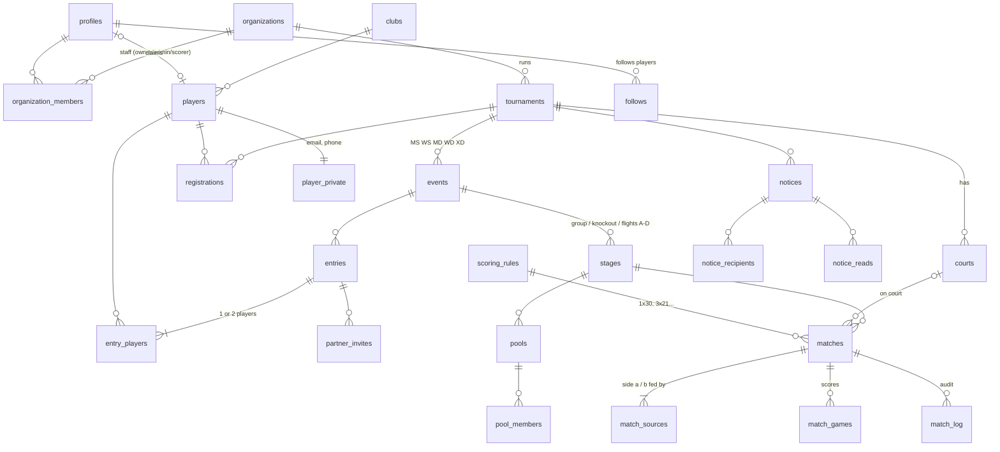

# Smashboard database schema

Postgres on Supabase. One migration: [`migrations/20261008120000_smashboard_init.sql`](migrations/20261008120000_smashboard_init.sql).
Status: **designed and validated locally, not yet applied to any Supabase project.**

## Principles

1. **The database guards the invariants; the TypeScript engine makes the decisions.**
   Seeding, pairing, club separation and bracket progression stay in `src/engine` (1,847 tests).
   Postgres stores the engine's output and refuses anything that would break match day,
   even if a client is buggy or two admins click at once.
2. **Public by default, private by design.** Anyone can follow a published tournament without
   logging in. Email, phone and birth year sit in a separate table only the player and the
   organizers can read.
3. **Every match change is audited.** A trigger writes who did what, before and after, to `match_log`.
4. **Match-day actions are single atomic calls** (`call_match`, `record_result`), so the
   "player is busy / resting" checks and the score validation can't race.

## Entity map

## Tables (26)

| Area | Table | Purpose |
|---|---|---|
| Reference | `scoring_rules` | Seeded presets: `BWF_3x21`, `BWF_3x15`, `ONE_30`, `ONE_31`, `ONE_21`, `ONE_15`, `ONE_11` (games, points, cap, interval). |
| People | `profiles` | One per Supabase Auth user, created by trigger on sign-up. |
| | `organizations`, `organization_members` | Who runs tournaments. Creator becomes `owner` automatically. Roles: `owner`, `admin`, `scorer`. |
| | `clubs` | Case-insensitive unique names, used for same-club separation. |
| | `players` | Public identity: name, gender, club, skill level A–D. Optionally claimed by a profile. |
| | `player_private` | Email, phone, birth year. Readable only by the player and organizers they registered with. |
| Tournament | `tournaments` | Slug, dates, venue, status `draft → registration → live → completed → archived`, default scoring (`rules_id` + `first_round_rules_id`), rest minutes, match-number counter. |
| | `courts` | Named courts with order and active flag. |
| | `events` | MS/WS/MD/WD/XD with draw config as real columns: mode (round robin, drop flight, knockout), group size, advance, AB/ABCD, 3rd place, plate, seeds, pairing (balanced/classic/random), scoring override, entry cap, fee. |
| Registration | `registrations` | Player × tournament, payment status. |
| | `entries` | A team in an event: status, seed, looking-for-partner. |
| | `entry_players` | 1 player (singles) or 2 (doubles), each with the skill level they gave **for this event** (singles and doubles levels can differ). |
| | `partner_invites` | Doubles partner named at registration who isn't registered yet: name, level, optional email, confirmation token (14 days). One per entry. |
| Draw | `stages` | Group stage, main knockout, flights A–D, 3rd-place match. |
| | `pools`, `pool_members` | Round-robin groups and their order. |
| | `matches` | Every match: number, round, position, scoring rules for that match, sides, status `pending → ready → on_court → finished` (or `bye`), court, called/started/finished times (the duration tag), live score, result, `version` for safe concurrent edits. |
| | `match_sources` | Where each side comes from: an entry, a bye, the winner/loser of another match, or rank N of a pool. This is the bracket graph. |
| | `match_games` | Points per game. |
| | `match_log` | Audit trail of every match change. |
| Comms | `notices`, `notice_recipients`, `notice_reads` | Court calls, announcements, delays; to everyone, one event, or chosen players; read receipts. |
| | `notification_prefs`, `follows` | Per-user preferences and followed players. |

## Rules enforced by Postgres

| Invariant | How |
|---|---|
| A court holds one match at a time | Partial unique index on `matches(court_id) where status = 'on_court'` |
| A player is on one court at a time | `check_player_free` trigger → error `player_busy` |
| Rest time between matches (unless the desk overrides) | `call_match` → error `player_resting` with "Name finished N min ago" |
| Game scores are possible under that match's rules (21-19 ok, 23-20 no, 30-29 ok, 31-29 no) | `check_game_score` trigger using `game_state()`, a port of `checkGame()` in `src/engine/rules.ts` |
| A finished match has a winner consistent with its games (or a retired/walkover/DQ result) | Deferred constraint trigger `validate_finished_match`, checked at commit |
| Singles have 1 player, doubles 2 (or 1 while looking for, or waiting on, a named partner); men's/women's events match gender; mixed is one man + one woman | Deferred constraint triggers on `entries` / `entry_players` |
| A player enters an event once | `unique (event_id, player_id)` on `entry_players` |
| Seeds unique within an event; match numbers unique within a tournament | Partial unique index; `unique (tournament_id, number)` |
| A match result feeds exactly one slot; bracket slots are unique | Unique indexes on `match_sources` and `matches` |
| Status fields agree with each other (on court ⇒ court + called time; finished ⇒ winner + result + finish time; times in order) | Table `check` constraints |
| Slugs, emails, phones, name lengths, dates (≤ 14-day event) | `check` constraints |

## Who can do what (row level security on all 26 tables, 58 policies)

| | Public (not signed in) | Player | Scorer | Admin / Owner |
|---|---|---|---|---|
| See published tournaments, draws, live scores, schedule | ✓ | ✓ | ✓ | ✓ |
| See draft tournaments | | | ✓ own org | ✓ own org |
| See contact details | | own | | ✓ registered players |
| Register, invite a partner | | ✓ | | ✓ |
| Call matches, live scores, enter results, send notices | | | ✓ | ✓ |
| Create events, courts, draws; accept entries; seed | | | | ✓ |
| Read the audit log | | | ✓ | ✓ |
| Manage staff | | | | owner |

Access checks use `security definer` helpers (`can_manage`, `can_score`, `is_visible`, …) so policies don't recurse into each other.

## Match-day functions (RPCs)

| Function | Does |
|---|---|
| `call_match(match, court, ignore_rest)` | Locks the match, checks it's ready, the court is free and active, nobody is playing, and rest time. Puts it on court. |
| `record_result(match, result, winner, games, expected_version)` | Replaces the games and finishes the match in one transaction. `expected_version` rejects stale edits (`stale_match`) if two admins enter the same slip. |
| `reserve_match_numbers(tournament, count)` | Hands out consecutive match numbers when a draw is published. |

Errors are short codes (`player_busy`, `player_resting`, `match_not_ready`, `stale_match`, `court_not_found`) with a readable detail, so the app can show the existing conflict dialog and toasts.

## Realtime

`matches`, `match_games`, `courts` and `notices` are in the `supabase_realtime` publication, so phones, the TV view and other admin screens update live without polling.

## What stays in the app

- Draw generation (seeding, A-vs-C / B-vs-D pairing, club separation, byes, drop flights).
- Progression: when a result is saved, the app moves the winner/loser into the next match using `match_sources`. (Can move into a database function later if we want results to propagate even with no app open.)
- Standings (BWF GCR 16.2 tie-breaks) are computed from `match_games`, not stored.

## Validation

Run locally against real Postgres 18 compiled to WebAssembly (PGlite), with a stub of Supabase's `auth` schema and roles:

- `node scripts/check-migration.mjs`: migration applies cleanly. 26 tables · 58 policies · 26 functions.
- `supabase/tests/schema.test.ts`: **19/19 pass.** Imports the full demo (3 tournaments, every event, draws, results, notices), then checks:
  - row counts match the demo, owner membership and profiles are created by triggers
  - round 1 uses `ONE_30`, later rounds `BWF_3x21`
  - a second match on a busy court is rejected; a busy player is rejected; rest time is enforced and can be overridden
  - impossible game scores are rejected (31-29 or 23-20 at 3×21; 31-20 or a second game at 1×30); a 24-30 single game finishes a `ONE_30` match
  - finished matches must agree with their games
  - wrong gender / wrong player count / duplicate entry are rejected
  - duplicate seeds, match numbers and bracket feeds are rejected; bad slugs and dates are rejected
  - every result in the log names who entered it
  - RLS: the public sees published data only and can't write; an outsider can't touch another org; a scorer can score but not edit events; an admin can manage; a player sees only their own private details
- Whole suite: **1,865 tests pass**, typecheck clean.

## Assumption to confirm

`ONE_30` is "first to 30 wins" with no deuce at 29-all (so 30-29 is a valid final score). If you play deuce to 32 or a 2-point lead, the preset is one line to change.
